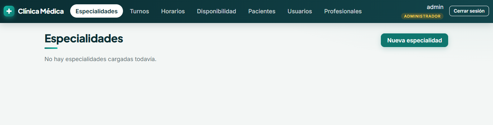
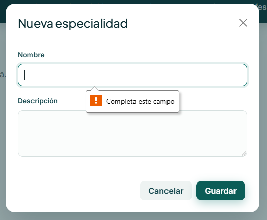
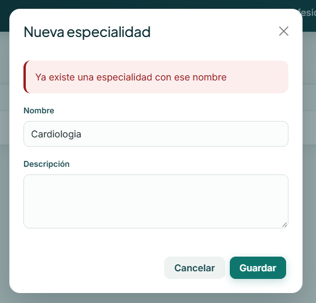
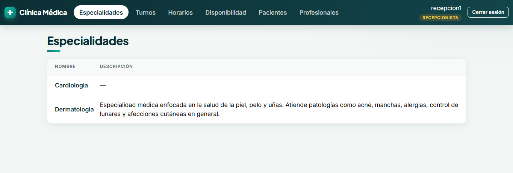
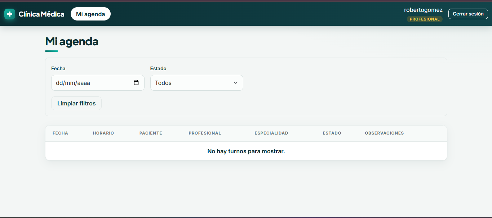
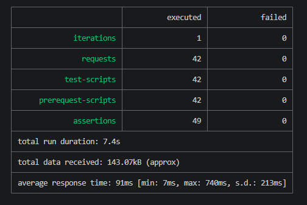

# Verificación del módulo Especialidades (frontend)

Responsable: Valentina Pascutti
Rama: `docs/verificacion-especialidades-valentina`, creada desde `main` actualizada (`b654788`).
Fecha de verificación: 25/10/2026

## Alcance

Pantalla `frontend/src/components/especialidades/EspecialidadesPage.tsx`, cliente `frontend/src/api/especialidades.ts` y su integración con `/api/especialidades`. No se modificaron `README.md`, `App.tsx` ni el código del módulo.

Permisos esperados:

| Rol | Menú Especialidades | Acciones |
| --- | --- | --- |
| Administrador | Sí | Listar, crear, editar y dar de baja |
| Recepcionista | Sí | Sólo consulta |
| Profesional | No (sólo ve Mi agenda) | Ninguna |

## Entorno

- Backend con H2 en memoria y administrador inicial:
  ```powershell
  .\backend\mvnw.cmd -f .\backend\pom.xml spring-boot:test-run "-Dspring-boot.run.arguments=--security.bootstrap.username=admin --security.bootstrap.password=<clave>"
  ```
- Frontend: `npm --prefix .\frontend run dev`, en `http://localhost:5173`.
- Los usuarios Recepcionista y Profesional se crearon como Administrador desde **Usuarios**. El Profesional quedó vinculado a un profesional activo.
- No se registran contraseñas ni tokens en este documento.

## Casos probados en la interfaz

Estado: **Aprobado**, **Corregido** (falló y se corrigió en otra rama) u **Observado** (funciona según el backend actual, pero se informó al equipo).

| # | Rol | Caso | Resultado esperado | Resultado obtenido | Estado |
| --- | --- | --- | --- | --- | --- |
| 1 | Administrador | Ingresar a Especialidades | Se muestra la lista y el botón "Nueva especialidad", sin errores | Sin especialidades cargadas, muestra "No hay especialidades cargadas todavía." y el botón (captura 1) | Aprobado |
| 2 | Administrador | Crear "Cardiología" con descripción | Se cierra el modal y aparece en la lista | Según lo esperado | Aprobado |
| 3 | Administrador | Crear sin nombre o sólo con espacios | El modal no se envía y muestra "El nombre es obligatorio." | Con el campo vacío, el navegador bloquea el envío ("Completa este campo", captura 2). Con sólo espacios, la app muestra "El nombre es obligatorio." | Aprobado |
| 4 | Administrador | Escribir más de 100 caracteres en nombre o 200 en descripción | El campo no deja escribir más del límite | Según lo esperado | Aprobado |
| 5 | Administrador | Crear otra "Cardiología" | Mensaje de nombre duplicado dentro del modal, sin cerrarlo | Se muestra "Ya existe una especialidad con ese nombre" y el modal sigue abierto (captura 3) | Aprobado |
| 6 | Administrador | Editar nombre y descripción | Se guardan y la tabla se actualiza | Según lo esperado | Aprobado |
| 7 | Administrador | Editar usando el nombre de otra especialidad | Mensaje de nombre duplicado, sin cambios | Según lo esperado | Aprobado |
| 8 | Administrador | Dar de baja y cancelar la confirmación | No se elimina nada | Según lo esperado | Aprobado |
| 9 | Administrador | Dar de baja y aceptar | Desaparece de la lista | Según lo esperado | Aprobado |
| 10 | Administrador | Recargar la página (F5) | La sesión sigue activa y se ven los últimos cambios | Según lo esperado | Aprobado |
| 11 | Administrador | Crear otra vez el nombre dado de baja | Ver observación 1 | Responde 409 "Ya existe una especialidad con ese nombre", aunque no figura en la lista | Observado |
| 12 | Recepcionista | Ingresar a Especialidades | Ve la lista, sin "Nueva especialidad" ni columna Acciones | Ve la lista sin botones ni columna Acciones (captura 4) | Aprobado |
| 13 | Profesional | Revisar el menú | Sólo aparece "Mi agenda"; no hay acceso a Especialidades | El menú sólo ofrece "Mi agenda" (captura 5) | Aprobado |
| 14 | Todos | Revisar la consola y la pestaña Red (F12) durante las operaciones correctas | Sin 401, 403, 404, 409 ni "Failed to fetch" | Según lo esperado | Aprobado |

## Casos probados contra la API (Postman)

Colección: `docs/especialidades.postman_collection.json`, con 42 solicitudes en 6 carpetas:

1. Preparación: rechazo sin JWT y con JWT inválido (401), login de los tres roles.
2. Administrador: listar, crear, consultar, duplicado (409), validaciones (400: sin nombre, nombre en blanco, más de 100 y más de 200 caracteres), editar, editar al nombre de otra (409) e inexistente (404).
3. Recepcionista: consulta (200); crear, editar y dar de baja rechazados (403).
4. Profesional: consulta el catálogo (200); crear, editar y dar de baja rechazados (403).
5. Baja lógica: 204, después 404 al consultarla o editarla, deja de figurar en la lista, segunda baja 404 y recreación con el nombre dado de baja (409, observación 1).
6. Limpieza: baja de los registros que creó la colección.

```powershell
npx --yes newman@6.2.1 run docs/especialidades.postman_collection.json --env-var "baseUrl=http://localhost:8080" --env-var "adminUsername=admin" --env-var "adminPassword=<clave>"
```

Resultado (25/10/2026, backend con H2): 42 solicitudes y 49 verificaciones, 0 fallos.

En una primera ejecución, la colección tenía además dos controles de "error sin traza", que fallaron por devtools (observación 4). Se quitaron porque dependen del modo de ejecución y no del módulo.

## Pruebas automatizadas del frontend

`frontend/tests/especialidades.test.mjs` ejecuta el cliente TypeScript real, sin agregar dependencias. Usa el mismo esquema que `profesionales.test.mjs`:

- Las cuatro operaciones envían `Authorization: Bearer`, usan la ruta y el método correctos y mandan el cuerpo JSON.
- Devuelven los datos del backend y resuelven la baja (204) sin leer JSON.
- Ante un error sin cuerpo, muestran un mensaje según el estado: 401, 403, 404, 409 y 500.
- Priorizan el mensaje del backend, tanto en `message` como en `detail`, e ignoran los mensajes vacíos.
- Un error de red rechaza la operación.
- Pendiente (`todo`): mostrar un mensaje comprensible ante un error de red (observación 2).

```powershell
node --test frontend/tests/especialidades.test.mjs
```

Resultado: 8 pruebas, 7 aprobadas, 0 fallidas, 1 pendiente (`todo`).

## Build, lint y pruebas del backend

| Comando | Resultado |
| --- | --- |
| `npm --prefix .\frontend run build` | Aprobado (TypeScript y Vite) |
| `npm --prefix .\frontend run lint` | Aprobado, sin advertencias |
| `node --test frontend/tests/especialidades.test.mjs` | 7 aprobadas, 1 pendiente |
| `node --test frontend/tests/profesionales.test.mjs` | 4 aprobadas |
| `.\backend\mvnw.cmd -f .\backend\pom.xml test` | 104 pruebas, 0 fallos, 0 errores, 0 omitidas (BUILD SUCCESS). Incluye 8 de `EspecialidadServiceTest` |

## Observaciones para el equipo

No se corrigieron en esta rama. Si se decide corregirlas, se hará en una rama específica.

1. **Un nombre dado de baja queda reservado.** La baja es lógica y la columna `nombre` es `UNIQUE`. Al crear o renombrar otra especialidad con ese nombre, el backend responde 409 ("Ya existe una especialidad con ese nombre"), aunque la especialidad no figure en la lista. No hay forma de reactivarla desde la API ni desde la interfaz. Opciones: agregar `PATCH /api/especialidades/{id}/reactivar`, como en Profesionales, o aclarar el mensaje.
2. **Error de red sin traducir.** Si el backend no está levantado, `api/especialidades.ts` muestra "Failed to fetch" tal cual. Profesionales, en cambio, muestra "No se pudo conectar con el servidor". Basta con envolver `fetch` en `try/catch`, igual que en `api/profesionales.ts`.
3. **400 sin mensaje propio.** El backend no expone el detalle de validación (`include-message=never`) y el cliente no tiene un texto para 400, así que mostraría "Ocurrió un error al comunicarse con el servidor". En la práctica no se alcanza, porque el formulario ya valida el nombre obligatorio y los largos máximos.
4. **Traza de Java en los errores durante el desarrollo.** Si el backend se levanta con `spring-boot:run` o `spring-boot:test-run`, `spring-boot-devtools` agrega `trace` a las respuestas de error (por ejemplo, en el 409 o en el 400), a pesar de que `application.properties` define `include-stacktrace=never`. Ocurre sólo en modo desarrollo: devtools no se incluye al empaquetar. Antes de la entrega conviene comprobarlo con el `.jar`. La colección no lo verifica, porque no es propio de este módulo.

## Capturas

Las capturas no muestran contraseñas ni tokens. Se tomaron con el tema visual propuesto en la rama `feature/estilos-frontend-valentina`, que sólo cambia CSS: el comportamiento es el mismo que en `main`.

**1. Administrador al ingresar, sin especialidades cargadas**



**2. Nombre obligatorio: el navegador impide guardar con el campo vacío**



**3. Nombre duplicado**



**4. Recepcionista: sólo consulta, sin acciones**



**5. Profesional: el menú sólo ofrece Mi agenda**



**6. Colección Postman con Newman: 42 solicitudes, 49 verificaciones, 0 fallos**



## Archivos de la entrega

- `docs/verificacion-especialidades-frontend.md` (este documento).
- `docs/especialidades.postman_collection.json` (nuevo).
- `frontend/tests/especialidades.test.mjs` (nuevo).
- `docs/capturas/especialidades/` (6 capturas).
